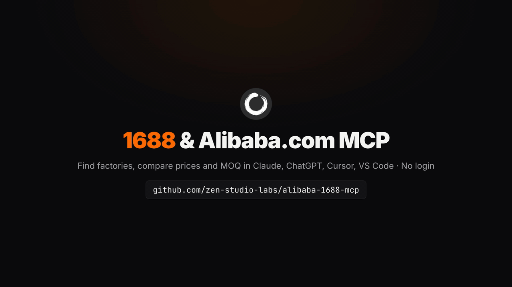
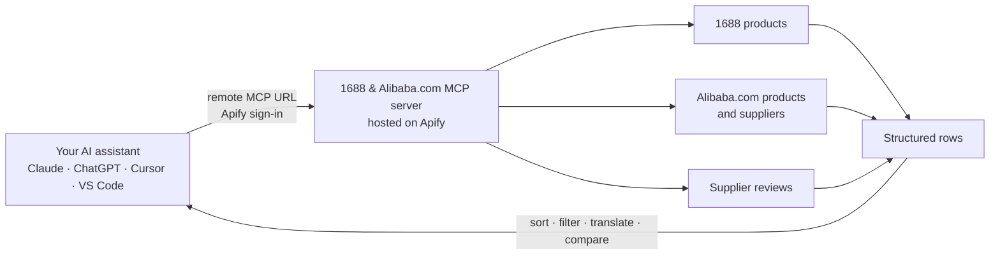

<div align="center">


# 1688 & Alibaba.com MCP Server

**1688 wholesale and Alibaba.com supplier data inside Claude, ChatGPT, Cursor and your own code: find factories, compare prices and MOQs, check supplier ratings and reviews. Hosted and read-only. No 1688 or Alibaba.com login, no cookies, nothing to install.**

**English** · [简体中文](README.zh-CN.md)

[](https://apify.com/zen-studio/1688-wholesale-scraper)
[](https://github.com/zen-studio-labs/alibaba-1688-mcp/actions/workflows/validate.yml)
[](LICENSE)



<sub>Built from a real 1688 and Alibaba.com search run on 2 November 2026.</sub>

[](https://cursor.com/en/install-mcp?name=alibaba-1688&config=eyJ1cmwiOiJodHRwczovL21jcC5hcGlmeS5jb20vP3Rvb2xzPWZldGNoLWFjdG9yLWRldGFpbHMsZ2V0LWFjdG9yLXJ1bixnZXQtZGF0YXNldC1pdGVtcyx6ZW4tc3R1ZGlvLzE2ODgtd2hvbGVzYWxlLXNjcmFwZXIsemVuLXN0dWRpby9hbGliYWJhLXNjcmFwZXIsemVuLXN0dWRpby9hbGliYWJhLXN1cHBsaWVyLXJldmlldy1zY3JhcGVyIn0=)
[](https://vscode.dev/redirect/mcp/install?name=alibaba-1688&config=%7B%22type%22%3A%22http%22%2C%22url%22%3A%22https%3A%2F%2Fmcp.apify.com%2F%3Ftools%3Dfetch-actor-details%2Cget-actor-run%2Cget-dataset-items%2Czen-studio%2F1688-wholesale-scraper%2Czen-studio%2Falibaba-scraper%2Czen-studio%2Falibaba-supplier-review-scraper%22%7D)
[](#client-setup)

[Quick start](#quick-start) · [Agent setup](#set-up-with-your-ai-agent) · [Tools](#tools) · [Prompts](#example-prompts) · [Client setup](#client-setup) · [API](#use-it-as-a-1688--alibabacom-api) · [Pricing](#pricing) · [FAQ](#faq)

</div>

1688 & Alibaba.com MCP is a hosted 1688 MCP server that connects your AI assistant to the two wholesale marketplaces sourcing buyers use most: 1688.com (阿里巴巴1688, China's domestic wholesale site) and Alibaba.com (the international B2B marketplace). Ask in English or Chinese: your assistant finds factories and wholesale listings, compares tiered prices and minimum order quantities (MOQ), checks sales, repeat-buyer rates and supplier verification, and reads Alibaba.com store reviews before you contact a supplier. Results come back as structured rows it can sort, filter, translate and convert into your currency. Developers can call the same tools as a 1688 API and an Alibaba.com API. It covers the 1688 and Alibaba.com marketplaces, not Alibaba Cloud.

## Why 1688 & Alibaba.com MCP

- **No 1688 or Alibaba.com account.** No QR-code or Alipay login, no cookies, no Chinese phone number, no slider captchas to solve. Your own buyer account is never used, so it is never at risk.
- **Nothing to install.** Add one URL and sign in with Apify. Works in claude.ai and ChatGPT too, not only in desktop apps.
- **Both marketplaces in one server.** 1688 wholesale products, Alibaba.com products and supplier profiles, and Alibaba.com store reviews, so one question can compare domestic and export prices.
- **The fields sourcing decisions need.** Quantity price tiers, MOQ, units sold, the shop's repeat-buyer rate (回头率), factory or trading-company type, province and city, dropshipping (一件代发) support, variant prices and stock, Alibaba.com price ladders, sample prices, certifications, response time and on-time delivery.
- **Maintained for you.** Used by more than 8,000 people on the Apify Store. When 1688 or Alibaba.com change, the tools are updated; your setup stays the same.
- **Made for assistants.** A bundled skill teaches your assistant the inputs that work and how to chain the tools, and long requests keep running while it checks back.
- **Pay per result.** Plus a small start fee per run, billed to your own Apify account. No subscription; try it on Apify's free plan.

| | 1688 & Alibaba.com MCP | Typical self-hosted 1688 tools |
|---|---|---|
| 1688 account, QR login or cookies | Not needed | Usually required |
| Slider captchas | Nothing for you to solve | Solved by hand in a browser window |
| Setup | One URL and an Apify sign-in | Python or Go, a local Chromium, sometimes Windows only |
| Web assistants (claude.ai, ChatGPT) | Supported | Usually desktop clients only |
| Alibaba.com products, suppliers and reviews | Included | Rarely; Alibaba.com servers are seller tools that need app keys |
| MOQ, price tiers, repeat-buyer rate, factory type | Included | Varies |
| When 1688 changes | Updated for you | Wait for a fix, or fix it yourself |
| Cost | Pay per result | Free software, your own machine and time |

## How it works



Each tool call starts a run on your Apify account. Your assistant waits for it, reads the rows, and answers in plain language. Chain the tools for deeper answers: search 1688 for factory prices, search Alibaba.com for export suppliers of the same product, then read the store reviews of the suppliers you shortlist.

## Quick start

1. **Create a free [Apify account](https://console.apify.com/sign-up)** if you do not have one.
2. **Add the server to your assistant.** Click a button above, or follow the steps for your client below.
3. **Sign in with Apify when your assistant asks**, then ask a question such as *"Find 1688 suppliers for stainless steel water bottles (不锈钢水杯) under ¥15 with their MOQ, and compare them with Alibaba.com suppliers."*

**About the Apify sign-in page.** Apify notes that your assistant "was registered dynamically and wasn't verified by Apify" and asks for full API access. Every assistant that signs in this way sees that notice; it lets your assistant start runs on your account. You can remove the access at any time on your [Apify Console integrations page](https://console.apify.com/settings/integrations).

Server URL, for any client that accepts a remote MCP server:

```text
https://mcp.apify.com/?tools=fetch-actor-details,get-actor-run,get-dataset-items,zen-studio/1688-wholesale-scraper,zen-studio/alibaba-scraper,zen-studio/alibaba-supplier-review-scraper
```

## Set up with your AI agent

Paste this repository's URL into Claude Code, Codex, Cursor or another agent and ask it to set up 1688 & Alibaba.com MCP. The steps below are written so your agent can follow them.

**For AI agents installing this server:**

1. This is a hosted remote MCP server (streamable HTTP). There is nothing to download or build. It needs a free Apify account and an Apify sign-in (OAuth) in the user's browser; do not ask for an API token unless the sign-in fails.
2. Server name `alibaba-1688`, server URL:
   ```text
   https://mcp.apify.com/?tools=fetch-actor-details,get-actor-run,get-dataset-items,zen-studio/1688-wholesale-scraper,zen-studio/alibaba-scraper,zen-studio/alibaba-supplier-review-scraper
   ```
3. Add it with the client's own command:
   - Claude Code: `claude plugin marketplace add zen-studio-labs/alibaba-1688-mcp`, then `claude plugin install alibaba-1688@alibaba-1688-mcp` (adds the server and the 1688 & Alibaba.com skill).
   - Codex: `codex mcp add alibaba-1688 --url "<server URL>"`, then `codex mcp login alibaba-1688`.
   - VS Code: `code --add-mcp '{"name":"alibaba-1688","type":"http","url":"<server URL>"}'`.
   - Cursor and other clients: add `{"mcpServers": {"alibaba-1688": {"url": "<server URL>"}}}` to the client's MCP config file (Cursor: `~/.cursor/mcp.json`).
4. Ask the user to complete the sign-in. In Claude Code they run `/mcp`, select alibaba-1688 and choose **Authenticate**; other clients open the Apify sign-in page themselves. A client restart may be needed before the tools appear.
5. Check it works without starting a paid run: call `fetch-actor-details` for `zen-studio/1688-wholesale-scraper` and confirm it returns the input reference. Do not run test searches: on Apify's free plan every run counts against a small allowance (25 runs in total for 1688 products), so keep runs for the user's real requests.
6. Before real requests, read the [1688 & Alibaba.com skill](skills/alibaba-1688/SKILL.md): it explains how long runs work, how the tools chain together and which inputs return good results.

## Tools

| Tool | What you get | Store page |
|---|---|---|
| 1688 products | 1688 wholesale listings for a keyword (Chinese or English) or for product IDs: title, price, quantity price tiers, MOQ, unit, units sold, the shop's repeat-buyer rate, review summary, images, shipping promise, province and city, and the supplier with company name, seller type (super factory, factory, merchant) and service scores. Filter by price in yuan, MOQ, province, city and verified tier; sort by best-selling or price. Product-ID lookups return the product without search filters, 30-day orders or the repeat-buyer rate, so keep those from the search that found it. Optional: the full variant matrix (colour, size, model) with price and stock per variant, and a supplier intelligence add-on with dropship metrics, resale channels and certificates. | [1688-wholesale-scraper](https://apify.com/zen-studio/1688-wholesale-scraper) |
| Alibaba.com products and suppliers | Products for a keyword or a whole category, with price ladder, MOQ, sample price, certifications, specs and the supplier's company profile (rating, response time, on-time delivery, location, years on Alibaba.com). Or supplier profiles directly, with main products, customization options and sample products with their MOQ. Prices and delivery follow your ship-to country. Filters for verified supplier, verified manufacturer, Trade Assurance, certifications, MOQ, price and delivery days. Optional: store reviews and verification reports. | [alibaba-scraper](https://apify.com/zen-studio/alibaba-scraper) |
| Supplier reviews | Every store review of an Alibaba.com supplier, from a storefront link, a product link or a company name: rating, review text in the buyer's language, buyer country, the reviewed product, photos, sub-scores for service, shipping and quality, and the store's overall rating breakdown. | [alibaba-supplier-review-scraper](https://apify.com/zen-studio/alibaba-supplier-review-scraper) |

All tools are read-only. They never place orders, send inquiries, message suppliers or post reviews.

<details>
<summary><b>Key fields per tool</b></summary>

| Tool | Key fields |
|---|---|
| 1688 products | `offerId`, `title`, `price.min`, `price.max`, `price.basis` (quantity or variant pricing), `quantityPrices`, `minOrderQuantity`, `unit`, `saledCount`, `soldDisplay`, `orderCount`, `repurchaseRate` (shop repeat-buyer rate, 回头率), `reviewSummary`, `province`, `city`, `supplier.companyName`, `supplier.sellerType`, `supplier.bizType`, `supplier.shopUrl`, `dropship.enabled`, `shipping`, `images`, `detailUrl`, and with variants on `skuDetails` |
| Alibaba.com products | `product.productId`, `product.title`, `product.price`, `product.moq`, `product.soldOrder`, `product.url`, `detail.ladderPrices`, `detail.moq`, `detail.sample`, `detail.certificationLogos`, `supplier.name`, `supplier.country`, `supplier.goldSupplierYears`, `supplier.homeUrl`, `supplier.companyId`, `companyProfile.averageStar`, `companyProfile.supplierResponseTime`, `companyProfile.SupplierOnTimeDeliveryRate` |
| Alibaba.com suppliers | `supplier.name`, `supplier.homeUrl`, `supplier.companyId`, `supplier.profile` (business type, join years, response time, reorder rate, main export markets), `supplier.tagList`, `supplier.customizationOptions`, `supplier.productList` (sample products with MOQ), `companyProfile` |
| Supplier reviews | `reviewContent`, `rating`, `ratingType`, `reviewTime`, `buyer.countryName`, `product.productName`, `media`, `orderSubScores`, `supplier.companyName`, `storeAggregate.averageScore`, `storeAggregate.totalReviews`, `storeAggregate.dimensions` |

Each Store page lists every field.

</details>

## Example prompts

**Find factories (1688)**
- *Find 1688 suppliers for stainless steel water bottles (不锈钢水杯) under ¥15, sorted by units sold, with price tiers and MOQ.*
- *Which 1688 factories in Yiwu (义乌) sell silicone phone cases with an MOQ of 10 or less? Show their repeat-buyer rates.*

**Compare 1688 with Alibaba.com**
- *Compare 1688 and Alibaba.com prices for LED strip lights: lowest tier price, MOQ and supplier rating on each, converted to USD.*
- *For yoga mats, show the five cheapest Alibaba.com offers shipping to Germany and the five best-selling 1688 offers side by side.*

**Vet a supplier (Alibaba.com)**
- *Find verified manufacturers of yoga mats on Alibaba.com with Trade Assurance, then read the store reviews of the top three.*
- *Read the reviews of this supplier and summarise complaints about shipping time: https://ansune1.en.alibaba.com/*

**Dropshipping and small orders**
- *Find 1688 pet water fountains that support dropshipping (一件代发) with an MOQ of 1, best-selling first.*
- *List every colour and size of 1688 product 577048715130 with its price and stock.*

**In Chinese**
- *在1688上找义乌的源头工厂，搜索“硅胶手机壳”，起批量10件以内，列出价格和回头率。*
- *对比1688和阿里巴巴国际站上不锈钢保温杯的价格和起订量。*

Tip: search 1688 in Chinese (`不锈钢水杯`, `手机壳`, `瑜伽垫`); that is how its suppliers title their listings, and it returns more products. Search Alibaba.com in English.

## Client setup

<details open>
<summary><b>Claude (claude.ai and Claude Desktop)</b></summary>

1. Open **Settings** > **Connectors** and select **Add custom connector**.
2. Name it `1688 Alibaba` and paste the server URL above.
3. Select **Connect** and sign in with Apify.
4. In a chat, enable the 1688 Alibaba connector from the tools menu.

The connector syncs between claude.ai and Claude Desktop. Custom connector availability depends on your Claude plan. For better results, also add the [1688 & Alibaba.com skill](skills/alibaba-1688/SKILL.md): download [alibaba-1688-skill.zip](https://github.com/zen-studio-labs/alibaba-1688-mcp/releases/latest/download/alibaba-1688-skill.zip) and upload it under **Skills** in Claude's settings.

</details>

<details>
<summary><b>Claude Code</b></summary>

Plugin (server plus the 1688 & Alibaba.com skill, recommended):

```text
/plugin marketplace add zen-studio-labs/alibaba-1688-mcp
/plugin install alibaba-1688@alibaba-1688-mcp
```

Server only:

```bash
claude mcp add --transport http alibaba-1688 "https://mcp.apify.com/?tools=fetch-actor-details,get-actor-run,get-dataset-items,zen-studio/1688-wholesale-scraper,zen-studio/alibaba-scraper,zen-studio/alibaba-supplier-review-scraper"
```

Then sign in: run `/mcp`, select the alibaba-1688 server and choose **Authenticate**. Until you do, `/mcp` lists the server as not authenticated and may say its tools could not be fetched; both clear once you sign in.

</details>

<details>
<summary><b>Cursor</b></summary>

Click **Install in Cursor** above, or add [`examples/cursor-mcp.json`](examples/cursor-mcp.json) to `~/.cursor/mcp.json` (all projects) or `.cursor/mcp.json` (one project). Cursor asks you to sign in with Apify on first use.

</details>

<details>
<summary><b>VS Code and GitHub Copilot</b></summary>

Click **Install in VS Code** above ([VS Code Insiders](https://insiders.vscode.dev/redirect/mcp/install?name=alibaba-1688&config=%7B%22type%22%3A%22http%22%2C%22url%22%3A%22https%3A%2F%2Fmcp.apify.com%2F%3Ftools%3Dfetch-actor-details%2Cget-actor-run%2Cget-dataset-items%2Czen-studio%2F1688-wholesale-scraper%2Czen-studio%2Falibaba-scraper%2Czen-studio%2Falibaba-supplier-review-scraper%22%7D&quality=insiders)), or add [`examples/vscode-mcp.json`](examples/vscode-mcp.json) to `.vscode/mcp.json`. Start the server from the MCP view and sign in with Apify when prompted. Use the tools in Copilot Chat agent mode.

</details>

<details>
<summary><b>ChatGPT</b></summary>

1. Open [ChatGPT Plugins](https://chatgpt.com/plugins), select **+**, then **Add custom MCP server**.
2. Name it `1688 Alibaba`, paste the server URL above, and choose **OAuth** authentication.
3. Confirm, create the plugin, and sign in with Apify.
4. In a new chat, type `@` and select **1688 Alibaba**.

Business, Enterprise and Edu workspaces may need an admin to enable custom servers. See OpenAI's [custom MCP server guide](https://help.openai.com/en/articles/12584461-connecting-custom-mcp-servers-in-chatgpt).

</details>

<details>
<summary><b>Codex</b></summary>

```bash
codex mcp add alibaba-1688 --url "https://mcp.apify.com/?tools=fetch-actor-details,get-actor-run,get-dataset-items,zen-studio/1688-wholesale-scraper,zen-studio/alibaba-scraper,zen-studio/alibaba-supplier-review-scraper"
codex mcp login alibaba-1688
```

Or copy [`examples/codex-config.toml`](examples/codex-config.toml) into `~/.codex/config.toml`.

</details>

<details>
<summary><b>Other clients, or a token instead of sign-in</b></summary>

Most clients that support remote MCP servers accept:

```json
{
  "mcpServers": {
    "alibaba-1688": {
      "url": "https://mcp.apify.com/?tools=fetch-actor-details,get-actor-run,get-dataset-items,zen-studio/1688-wholesale-scraper,zen-studio/alibaba-scraper,zen-studio/alibaba-supplier-review-scraper"
    }
  }
}
```

If your client cannot complete the Apify sign-in, send your Apify token as a header instead, see [`examples/bearer-token-mcp.json`](examples/bearer-token-mcp.json). Copy the token from your [Apify Console integrations page](https://console.apify.com/settings/integrations) and keep it out of shared files. Clients that only run local servers can bridge with `mcp-remote`, see [`examples/claude-desktop-config.json`](examples/claude-desktop-config.json).

</details>

## Use it as a 1688 / Alibaba.com API

Each tool is also an [Apify Actor](https://apify.com/zen-studio) with a REST API, so you can call it from your own code, a pipeline or an automation, without an assistant. Copy your API token from the [Apify Console integrations page](https://console.apify.com/settings/integrations). The input fields are the same ones the assistant uses; each Store page has an **API** tab with ready-made code and the full input reference.

<details open>
<summary><b>Python</b></summary>

```bash
pip install apify-client
```

```python
import os
from apify_client import ApifyClient

client = ApifyClient(os.environ["APIFY_TOKEN"])
run = client.actor("zen-studio/1688-wholesale-scraper").call(
    run_input={"keywords": ["不锈钢水杯"], "maxResults": 20, "priceMax": 15, "sortBy": "bestSelling"}
)
for item in client.dataset(run["defaultDatasetId"]).iterate_items():
    if item.get("limit_reached") or item.get("retry_later") or "price" not in item:
        print("notice:", item.get("message") or item.get("error"))  # not a product row
        continue
    if item.get("error"):
        print("partial:", item["error"])  # usable product, some fields missing
    print(item["price"]["min"], item["minOrderQuantity"], item["title"], item["detailUrl"])
```

</details>

<details>
<summary><b>JavaScript and TypeScript</b></summary>

```bash
npm install apify-client
```

```js
import { ApifyClient } from 'apify-client';

const client = new ApifyClient({ token: process.env.APIFY_TOKEN });
const run = await client.actor('zen-studio/alibaba-scraper').call({
    keywords: ['stainless steel water bottle'],
    maxResults: 20,
    shipToCountry: 'US',
});
const { items } = await client.dataset(run.defaultDatasetId).listItems();
console.log(items);
```

</details>

<details>
<summary><b>HTTP</b></summary>

Start a run and get its results in one request:

```bash
curl -X POST "https://api.apify.com/v2/acts/zen-studio~1688-wholesale-scraper/run-sync-get-dataset-items" \
  -H "Authorization: Bearer $APIFY_TOKEN" \
  -H "Content-Type: application/json" \
  -d '{"keywords": ["不锈钢水杯"], "maxResults": 20, "priceMax": 15}'
```

This waits up to 300 seconds. For bigger runs, start the run asynchronously and read its dataset when it finishes, see the [Apify API reference](https://docs.apify.com/api/v2/act-run-sync-get-dataset-items-post).

</details>

<details>
<summary><b>n8n, Make and Zapier</b></summary>

Use Apify's integration for [n8n](https://docs.apify.com/platform/integrations/n8n), [Make](https://docs.apify.com/platform/integrations/make) or [Zapier](https://docs.apify.com/platform/integrations/zapier), choose the Actor (for example `zen-studio/1688-wholesale-scraper`) and pass the same JSON input.

</details>

Other tools: replace the Actor ID with `zen-studio/alibaba-scraper` or `zen-studio/alibaba-supplier-review-scraper`.

## Use cases

- **Find factories (找工厂).** Manufacturers for a product, filtered by price, MOQ, province or city and verified tier, with units sold and repeat-buyer rates.
- **Price and MOQ comparison.** The same product on 1688 and Alibaba.com, tier by tier, so you see the gap between domestic wholesale and export offers.
- **Supplier vetting.** Alibaba.com ratings, response time, on-time delivery, verification and the full review history before you send an inquiry.
- **Dropshipping research (一件代发).** Products with an MOQ of 1, dropship support, shipping promise and variant stock.
- **Amazon and Shopify product research.** Landed-cost inputs per variant: price tiers, unit weight and shipping estimates.
- **Price monitoring.** Run the same search on a schedule and track price tiers and sales over time.

## Example output

One 1688 products row from the run behind the demo, abridged. Your assistant reads rows like this and answers in plain language.

```json
{
  "offerId": "577048715130",
  "title": "源头厂家简约不锈钢水杯带柄便捷随手杯 户外男女水登山水杯",
  "price": { "min": 6, "max": 6.2, "currency": "CNY", "basis": "quantity" },
  "quantityPrices": [
    { "quantityRange": "100~999个", "quantityMin": 100, "quantityMax": 999, "price": 6.2 },
    { "quantityRange": "≥1000个", "quantityMin": 1000, "quantityMax": null, "price": 6 }
  ],
  "minOrderQuantity": 100,
  "unit": "个",
  "saledCount": 59200,
  "soldDisplay": "已售5.9万+件",
  "repurchaseRate": 0.61,
  "province": "浙江",
  "city": "永康市",
  "supplier": {
    "companyName": "永康市聚鑫金属制品有限公司",
    "sellerType": "normal_factory",
    "bizType": "生产加工",
    "shopUrl": "http://ykk5527.1688.com"
  },
  "dropship": { "enabled": true },
  "shipping": { "deliveryDays": 3, "carrier": "中通快递", "unitWeight": 0.8, "location": "浙江金华" },
  "detailUrl": "http://detail.1688.com/offer/577048715130.html"
}
```

## How long requests work

Each tool call returns within about 45 seconds. Bigger requests keep running on Apify after that, and your assistant checks back until the results are ready, then reads them in pages. You may see a few "still running" updates; that is expected. The [1688 & Alibaba.com skill](skills/alibaba-1688/SKILL.md) teaches assistants this flow, along with input recipes for each tool. Claude Code gets it with the plugin.

## Pricing

Pay per result plus a small start fee per run, billed to your Apify account. There is no subscription to this repository. Current prices, including volume discounts, are on each tool's pricing page:

- [1688 products](https://apify.com/zen-studio/1688-wholesale-scraper/pricing)
- [Alibaba.com products and suppliers](https://apify.com/zen-studio/alibaba-scraper/pricing)
- [Supplier reviews](https://apify.com/zen-studio/alibaba-supplier-review-scraper/pricing)

Optional add-ons (1688 supplier intelligence, Alibaba.com store reviews and verification reports) are billed per item, and only when you turn them on. Your assistant controls cost through result caps such as `maxResults`. Ask for a small number first, then scale up.

**Free Apify plan:** 1688 products allow 25 preview runs in total, up to 20 products per run, first search term only. Alibaba.com products, suppliers and supplier reviews have no separate free-plan cap: they run normally and are billed per result against your plan's monthly credit, so set `maxResults` and review limits. Any paid Apify plan removes the 1688 cap.

## Limitations

- **No search by image.** Search by keyword, category or product ID.
- **No 1688 product reviews.** 1688 rows carry the review summary (rating and counts); full review text is available for Alibaba.com suppliers only.
- **No phone numbers or email addresses.** Use the supplier's storefront link (`supplier.shopUrl` on 1688, `supplier.homeUrl` on Alibaba.com) and contact them on the marketplace.
- **Read-only.** No orders, inquiries, quotes (RFQ) or messages.
- **Currencies differ.** 1688 prices are in yuan (CNY) and exclude international shipping; Alibaba.com prices follow the ship-to country you set.

Use the data responsibly and in line with the 1688 and Alibaba.com terms and the data protection laws that apply to you, such as PIPL and GDPR. Supplier contact names and reviewer details are personal data.

## Troubleshooting

- **`/mcp` says the server is not authenticated, or its tools could not be fetched.** Select the server and choose **Authenticate**. Other clients show a **Connect** or **Sign in** button.
- **A 1688 search returns few or unrelated products.** Search in Chinese, add words to `excludeKeywords` for a second meaning (for example `包` to drop bags), or widen the price range.
- **A 1688 search stopped at 20 results, or only the first search term ran.** That is the free Apify plan's 1688 preview. Any paid plan removes it.
- **A free run says the free preview is temporarily unavailable.** Try again shortly, or use any paid Apify plan.
- **A 1688 product ID comes back with an `error` field.** The message says whether the listing is gone or should be retried in a new run.
- **Alibaba.com prices or delivery look different from the website.** Set `shipToCountry` to the country you buy for.
- **Your assistant says a run is still going.** That is normal for bigger requests. Ask it to keep checking the same run; a new request for the same question is billed again.
- **Your client cannot complete the sign-in.** Use an Apify token header instead, see [Other clients](#client-setup).

## FAQ

**What are 1688 and Alibaba.com?**
Both are wholesale marketplaces run by Alibaba Group. 1688.com (阿里巴巴1688) is China's domestic B2B site, in Chinese and priced in yuan, where factories sell to Chinese resellers, often at lower prices and smaller minimum orders. Alibaba.com is the international site where Chinese and other suppliers sell to buyers abroad, in English and with export pricing.

**Is this Alibaba Cloud?**
No. This server reads product and supplier data from the 1688 and Alibaba.com marketplaces. It has nothing to do with Alibaba Cloud (Aliyun) services or their MCP servers.

**How is this different from open-source 1688 MCP servers?**
Open-source servers run a browser on your machine with your own logged-in 1688 account, and you solve the slider captchas yourself; Alibaba.com servers are seller tools that need developer keys. 1688 & Alibaba.com MCP is hosted and read-only: no account, nothing to run, it covers both marketplaces from the buyer's side, and it works in web assistants such as claude.ai and ChatGPT.

**Do I need a 1688 or Alibaba.com account, or a Chinese phone number?**
No. You only need an Apify account, which takes a minute to create.

**Can it place orders or contact suppliers?**
No. All tools are read-only by design.

**Is the data live?**
Yes. Prices, stock, sales and supplier stats reflect the marketplaces at the moment you ask.

**Can I search 1688 in English?**
Yes, but Chinese keywords return more and better matches, because 1688 suppliers title their listings in Chinese. Your assistant can translate your keyword and the results.

**Which AI assistants work with it?**
Any client that supports remote MCP servers, including Claude (claude.ai, Claude Desktop, Claude Code), ChatGPT, Codex, Cursor, VS Code with GitHub Copilot and many more.

**Is there a 1688 API or an Alibaba.com API?**
Yes. Every tool can be called over a REST API or with Apify's Python and JavaScript clients, see [Use it as an API](#use-it-as-a-1688--alibabacom-api).

**Is it free?**
You can try it on Apify's free plan. Results are billed against the plan's monthly credit from the first run; 1688 products also have a 25-run preview limit on the free plan. See [Pricing](#pricing).

**Is this an official 1688 or Alibaba.com product?**
No. 1688 & Alibaba.com MCP is an independent product by Zen Studio and is not affiliated with 1688, Alibaba.com or Alibaba Group.

## Privacy

Requests go to Apify's hosted MCP server and run on your Apify account. Apify's [privacy policy](https://docs.apify.com/legal/privacy-policy) applies. This repository contains configuration and instructions only; it collects nothing.

## More from Zen Studio

1688 & Alibaba.com MCP is built on [Zen Studio's Apify Actors](https://apify.com/zen-studio). You can also run each tool directly on Apify, from its API, or on a schedule.

- [Goofish MCP](https://github.com/zen-studio-labs/goofish-mcp): Xianyu (闲鱼) second-hand listings, prices and sellers.
- [RedNote MCP](https://github.com/zen-studio-labs/rednote-xiaohongshu-mcp): Xiaohongshu (小红书) notes, comments and creators, for product and trend research.

## License

[MIT](LICENSE). 1688, 1688.com, Alibaba, Alibaba.com and 阿里巴巴 are trademarks of their respective owners.
