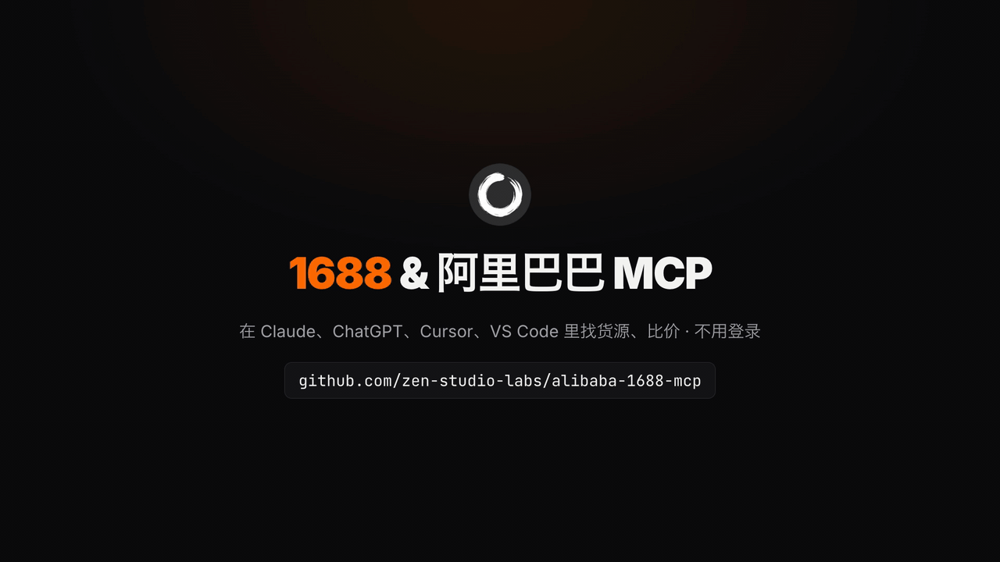
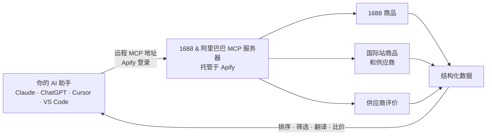

<div align="center">


# 1688 & 阿里巴巴 MCP（1688 / Alibaba.com MCP Server）

**让 Claude、ChatGPT、Cursor 等 AI 助手直接在 1688 找货源、找工厂，对比阶梯价和起批量，再到阿里巴巴国际站查供应商评分和买家评价。云端托管，只读，不用登录 1688，不用 Cookie，不用部署，也可通过 API 调用。**

[English](README.md) · **简体中文**

[](https://apify.com/zen-studio/1688-wholesale-scraper)
[](https://github.com/zen-studio-labs/alibaba-1688-mcp/actions/workflows/validate.yml)
[](LICENSE)



<sub>画面数据来自 2026 年 11 月 2 日在 1688 和阿里巴巴国际站的一次真实搜索。</sub>

[](https://cursor.com/en/install-mcp?name=alibaba-1688&config=eyJ1cmwiOiJodHRwczovL21jcC5hcGlmeS5jb20vP3Rvb2xzPWZldGNoLWFjdG9yLWRldGFpbHMsZ2V0LWFjdG9yLXJ1bixnZXQtZGF0YXNldC1pdGVtcyx6ZW4tc3R1ZGlvLzE2ODgtd2hvbGVzYWxlLXNjcmFwZXIsemVuLXN0dWRpby9hbGliYWJhLXNjcmFwZXIsemVuLXN0dWRpby9hbGliYWJhLXN1cHBsaWVyLXJldmlldy1zY3JhcGVyIn0=)
[](https://vscode.dev/redirect/mcp/install?name=alibaba-1688&config=%7B%22type%22%3A%22http%22%2C%22url%22%3A%22https%3A%2F%2Fmcp.apify.com%2F%3Ftools%3Dfetch-actor-details%2Cget-actor-run%2Cget-dataset-items%2Czen-studio%2F1688-wholesale-scraper%2Czen-studio%2Falibaba-scraper%2Czen-studio%2Falibaba-supplier-review-scraper%22%7D)
[](#客户端配置)

[快速开始](#快速开始) · [让 AI 帮你安装](#让-ai-助手帮你安装) · [工具](#工具) · [提问示例](#提问示例) · [客户端配置](#客户端配置) · [API](#1688-和阿里巴巴-api代码调用) · [价格](#价格) · [常见问题](#常见问题)

</div>

1688 & 阿里巴巴 MCP 是一个云端托管的 1688 MCP 服务器，把你的 AI 助手接入做采购最常用的两个批发平台：1688（阿里巴巴1688，1688.com，国内批发货源）和阿里巴巴国际站（Alibaba.com，外贸 B2B）。用中文或英文提问都行：按关键词找货源和源头工厂，对比阶梯价、起批量（MOQ）、销量、回头率和厂家类型，查看是否支持一件代发，再到阿里巴巴国际站核对供应商评分、响应时间、准时发货率和买家评价。结果是结构化数据，AI 助手可以直接排序、筛选、翻译和换算币种；开发者也可以把它当作 1688 API 和阿里巴巴国际站 API 在代码里调用。本项目只涉及 1688 和阿里巴巴国际站，与阿里云无关。

## 为什么选择 1688 & 阿里巴巴 MCP

- **不用登录，不怕封号。** 不用扫码或支付宝登录，不用导出 Cookie，不用手动拖滑块验证码。全程不使用你的 1688 采购账号，账号不会因此受影响。
- **无需部署。** 云端托管的远程 MCP 服务：填入一个 URL，登录 Apify 即可使用。不用装 Python、Go 或本地浏览器，也不挑 Windows 还是 Mac；网页版 claude.ai 和 ChatGPT 也能用。
- **国内批发和外贸一个服务器搞定。** 1688 商品、阿里巴巴国际站商品和供应商、国际站店铺评价，一个问题就能对比同款在国内拿货价和外贸报价。
- **采购真正要看的字段。** 阶梯价、起批量、销量、店铺回头率、生产加工还是经销批发、所在省市、是否支持一件代发、规格（颜色、尺码）的单独价格和库存；国际站的阶梯报价、样品价、认证、响应时间和准时发货率。
- **持续维护。** Apify Store 上已有超过 8,000 名用户。1688 或阿里巴巴国际站改版时我们负责适配，你的配置不用改。
- **为 AI 助手优化。** 自带 Skill，告诉 AI 助手怎么传参、怎么组合调用各个工具；耗时较长的任务在后台继续跑，AI 助手会自动轮询进度。
- **按量付费。** 按返回结果计费（另有少量单次启动费），从你自己的 Apify 账号扣费，无需订阅，可用 Apify 免费套餐试用。

| | 1688 & 阿里巴巴 MCP | 开源自部署方案 |
|---|---|---|
| 1688 账号、扫码登录或 Cookie | 不需要 | 通常需要 |
| 滑块验证码 | 不用你处理 | 弹出浏览器窗口，自己手动拖 |
| 安装配置 | 一个地址加一次 Apify 登录 | Python 或 Go、本地 Chromium，有的只支持 Windows |
| 网页版 AI 助手（claude.ai、ChatGPT） | 支持 | 通常只支持桌面客户端 |
| 阿里巴巴国际站商品、供应商和评价 | 全部包含 | 很少有；国际站相关项目多为卖家工具，要申请开放平台密钥 |
| 起批量、阶梯价、回头率、厂家类型 | 全部包含 | 不一定 |
| 1688 改版后 | 我们负责适配 | 等作者修复，或自己修 |
| 成本 | 按结果计费 | 软件免费，但要自己维护环境、花时间折腾 |

## 工作原理



每次调用工具，都会在你的 Apify 账号下创建一个运行任务（Run）。AI 助手等任务完成后读取数据，再用自然语言回答你。多个工具可以组合使用：先在 1688 查工厂价，再到阿里巴巴国际站找同款的外贸供应商，最后读取入围供应商的店铺评价。

## 快速开始

1. 注册免费的 [Apify 账号](https://console.apify.com/sign-up)。
2. **把服务器添加到 AI 助手。** 点击上方按钮，或按下方对应客户端的步骤操作。
3. **AI 助手提示时登录 Apify**，然后直接提问，例如：“在 1688 上找 15 元以内的不锈钢水杯厂家，列出起批量，再和阿里巴巴国际站的供应商比一比。”

**关于 Apify 授权页面。** 页面会提示该应用为“动态注册、未经 Apify 验证”，并请求完整的 API 访问权限。所有以这种方式登录的 AI 助手都会看到这一提示，它允许 AI 助手在你的账号上启动运行。授权可随时在 [Apify 控制台集成页面](https://console.apify.com/settings/integrations) 撤销。

服务器地址，适用于所有支持远程 MCP 服务器的客户端：

```text
https://mcp.apify.com/?tools=fetch-actor-details,get-actor-run,get-dataset-items,zen-studio/1688-wholesale-scraper,zen-studio/alibaba-scraper,zen-studio/alibaba-supplier-review-scraper
```

## 让 AI 助手帮你安装

把本仓库的地址粘贴给 Claude Code、Codex、Cursor 或其他 AI 助手，让它帮你安装 1688 & 阿里巴巴 MCP。下面的步骤专门写给 AI 助手执行。

**以下内容供 AI 助手执行：**

1. 这是一个托管的远程 MCP 服务器（streamable HTTP），无需下载或构建。需要一个免费的 Apify 账号，并在用户浏览器中完成 Apify 登录（OAuth）；除非登录失败，否则不要向用户索要 API Token。
2. 服务器名称 `alibaba-1688`，服务器地址：
   ```text
   https://mcp.apify.com/?tools=fetch-actor-details,get-actor-run,get-dataset-items,zen-studio/1688-wholesale-scraper,zen-studio/alibaba-scraper,zen-studio/alibaba-supplier-review-scraper
   ```
3. 使用客户端自带的命令添加：
   - Claude Code：`claude plugin marketplace add zen-studio-labs/alibaba-1688-mcp`，然后 `claude plugin install alibaba-1688@alibaba-1688-mcp`（同时安装服务器和 1688 & 阿里巴巴技能）。
   - Codex：`codex mcp add alibaba-1688 --url "<服务器地址>"`，然后 `codex mcp login alibaba-1688`。
   - VS Code：`code --add-mcp '{"name":"alibaba-1688","type":"http","url":"<服务器地址>"}'`。
   - Cursor 及其他客户端：在客户端的 MCP 配置文件中加入 `{"mcpServers": {"alibaba-1688": {"url": "<服务器地址>"}}}`（Cursor：`~/.cursor/mcp.json`）。
4. 请用户完成登录。在 Claude Code 中运行 `/mcp`，选择 alibaba-1688 并点击 **Authenticate**；其他客户端会自动打开 Apify 登录页面。工具出现前可能需要重启客户端。
5. 不启动付费运行即可验证：对 `zen-studio/1688-wholesale-scraper` 调用 `fetch-actor-details`，能返回输入说明即说明连接正常。不要做测试搜索：Apify 免费套餐下每次运行都计入很少的额度（1688 商品共 25 次），留给用户的真实需求。
6. 正式使用前，请阅读 [1688 & 阿里巴巴技能](skills/alibaba-1688/SKILL.md)：其中说明了长时间运行的处理方式、工具串联方法以及效果最好的参数。

## 工具

| 工具 | 返回内容 | Apify 页面 |
|---|---|---|
| 1688 商品 | 按关键词（中文或英文）或商品 ID（offerId）获取 1688 批发商品：标题、价格、阶梯价、起批量、单位、销量、店铺回头率、评价概况、图片、发货承诺、所在省市，以及供应商的公司名、商家类型（超级工厂、工厂、实力商家）和服务评分。可按价格（元）、起批量、省份、城市、商家等级筛选，按综合、销量或价格排序。按商品 ID 查询时不套用搜索筛选，也不含近 30 天订单数和回头率，这两项请沿用搜索结果中的数据。可选：完整规格表（颜色、尺码、型号）及每个规格的价格和库存；付费附加项“供应商洞察”含代发数据、授权销售渠道和资质证书。 | [1688-wholesale-scraper](https://apify.com/zen-studio/1688-wholesale-scraper) |
| 国际站商品和供应商 | 按关键词或整个类目获取阿里巴巴国际站商品：阶梯报价、起订量、样品价、认证、规格参数，以及供应商公司档案（评分、响应时间、准时发货率、所在地、入驻年限）。也可直接搜索供应商，返回主营产品、定制能力和带起订量的样品商品。价格和配送按你选择的收货国家显示。可筛选认证供应商、认证工厂、信保（Trade Assurance）、产品认证、起订量、价格和交货天数。可选：店铺评价和验厂报告。 | [alibaba-scraper](https://apify.com/zen-studio/alibaba-scraper) |
| 供应商评价 | 通过国际站店铺链接、商品链接或公司名，获取供应商的全部店铺评价：评分、买家原文评价、买家国家、所评商品、图片、服务/物流/质量分项评分，以及店铺整体评分分布。 | [alibaba-supplier-review-scraper](https://apify.com/zen-studio/alibaba-supplier-review-scraper) |

所有工具均为只读，不会下单、询盘、联系供应商或发布评价。

<details>
<summary><b>各工具主要字段</b></summary>

| 工具 | 主要字段 |
|---|---|
| 1688 商品 | `offerId`、`title`、`price.min`、`price.max`、`price.basis`（按数量或按规格定价）、`quantityPrices`（阶梯价）、`minOrderQuantity`（起批量）、`unit`、`saledCount`、`soldDisplay`、`orderCount`、`repurchaseRate`（店铺回头率）、`reviewSummary`、`province`、`city`、`supplier.companyName`、`supplier.sellerType`、`supplier.bizType`、`supplier.shopUrl`、`dropship.enabled`（一件代发）、`shipping`、`images`、`detailUrl`，开启规格后另有 `skuDetails` |
| 国际站商品 | `product.productId`、`product.title`、`product.price`、`product.moq`、`product.soldOrder`、`product.url`、`detail.ladderPrices`、`detail.moq`、`detail.sample`、`detail.certificationLogos`、`supplier.name`、`supplier.country`、`supplier.goldSupplierYears`、`supplier.homeUrl`、`supplier.companyId`、`companyProfile.averageStar`、`companyProfile.supplierResponseTime`、`companyProfile.SupplierOnTimeDeliveryRate` |
| 国际站供应商 | `supplier.name`、`supplier.homeUrl`、`supplier.companyId`、`supplier.profile`（经营类型、入驻年限、响应时间、复购率、主要出口市场）、`supplier.tagList`、`supplier.customizationOptions`、`supplier.productList`（带起订量的样品商品）、`companyProfile` |
| 供应商评价 | `reviewContent`、`rating`、`ratingType`、`reviewTime`、`buyer.countryName`、`product.productName`、`media`、`orderSubScores`、`supplier.companyName`、`storeAggregate.averageScore`、`storeAggregate.totalReviews`、`storeAggregate.dimensions` |

完整字段见各工具的 Apify 页面。

</details>

## 提问示例

**找工厂、找货源（1688）**
- *在 1688 上找 15 元以内的不锈钢水杯，按销量排序，列出阶梯价和起批量。*
- *义乌有哪些做硅胶手机壳的源头工厂，起批量 10 件以内？列出回头率。*

**1688 和国际站比价**
- *对比 1688 和阿里巴巴国际站上 LED 灯带的价格：最低档阶梯价、起订量和供应商评分，统一换算成人民币。*
- *瑜伽垫：列出国际站发往德国最便宜的 5 个报价，和 1688 销量最高的 5 个商品放在一起对比。*

**供应商背调（国际站）**
- *在阿里巴巴国际站找支持信保的瑜伽垫认证工厂，再读取前三家的店铺评价。*
- *读取这家供应商的评价，总结买家对发货时效的吐槽：https://ansune1.en.alibaba.com/*

**一件代发和小批量拿货**
- *在 1688 上找支持一件代发、1 件起批的宠物饮水机，按销量排序。*
- *列出 1688 商品 577048715130 的所有颜色和尺码，以及每个规格的价格和库存。*

**跨境选品（亚马逊、Shopify、TikTok Shop 卖家）**
- *帮我找 1688 上 20 元以内、带重量信息的折叠收纳箱，估算每件的拿货成本。*
- *最近 30 天 1688 上订单最多的露营灯有哪些？列出单价、起批量和发货地。*

提示：在 1688 上请用中文关键词搜索（如 `不锈钢水杯`、`手机壳`、`瑜伽垫`），商家标题都是中文，结果更多更准；阿里巴巴国际站用英文关键词。

## 客户端配置

<details open>
<summary><b>Claude（claude.ai 和 Claude Desktop）</b></summary>

1. 打开 **Settings** > **Connectors**，选择 **Add custom connector**。
2. 名称填写 `1688 Alibaba`，粘贴上方的服务器地址。
3. 点击 **Connect** 并登录 Apify。
4. 在对话中，从工具菜单启用 1688 Alibaba 连接器。

连接器会在 claude.ai 和 Claude Desktop 之间同步。自定义连接器是否可用取决于你的 Claude 套餐。建议同时添加 [1688 & 阿里巴巴技能](skills/alibaba-1688/SKILL.md)：下载 [alibaba-1688-skill.zip](https://github.com/zen-studio-labs/alibaba-1688-mcp/releases/latest/download/alibaba-1688-skill.zip)，在 Claude 设置的 **Skills** 中上传。

</details>

<details>
<summary><b>Claude Code</b></summary>

插件（服务器加 1688 & 阿里巴巴技能，推荐）：

```text
/plugin marketplace add zen-studio-labs/alibaba-1688-mcp
/plugin install alibaba-1688@alibaba-1688-mcp
```

仅添加服务器：

```bash
claude mcp add --transport http alibaba-1688 "https://mcp.apify.com/?tools=fetch-actor-details,get-actor-run,get-dataset-items,zen-studio/1688-wholesale-scraper,zen-studio/alibaba-scraper,zen-studio/alibaba-supplier-review-scraper"
```

然后登录：运行 `/mcp`，选择 alibaba-1688 服务器并点击 **Authenticate**。登录前，`/mcp` 会显示服务器未认证，并可能提示无法获取工具；登录后即恢复正常。

</details>

<details>
<summary><b>Cursor</b></summary>

点击上方的 **Install in Cursor**，或把 [`examples/cursor-mcp.json`](examples/cursor-mcp.json) 加入 `~/.cursor/mcp.json`（所有项目）或 `.cursor/mcp.json`（单个项目）。首次使用时 Cursor 会提示登录 Apify。

</details>

<details>
<summary><b>VS Code 和 GitHub Copilot</b></summary>

点击上方的 **Install in VS Code**（[VS Code Insiders](https://insiders.vscode.dev/redirect/mcp/install?name=alibaba-1688&config=%7B%22type%22%3A%22http%22%2C%22url%22%3A%22https%3A%2F%2Fmcp.apify.com%2F%3Ftools%3Dfetch-actor-details%2Cget-actor-run%2Cget-dataset-items%2Czen-studio%2F1688-wholesale-scraper%2Czen-studio%2Falibaba-scraper%2Czen-studio%2Falibaba-supplier-review-scraper%22%7D&quality=insiders)），或把 [`examples/vscode-mcp.json`](examples/vscode-mcp.json) 加入 `.vscode/mcp.json`。在 MCP 视图中启动服务器，并按提示登录 Apify。在 Copilot Chat 的 Agent 模式中使用这些工具。

</details>

<details>
<summary><b>ChatGPT</b></summary>

1. 打开 [ChatGPT Plugins](https://chatgpt.com/plugins)，点击 **+**，选择 **Add custom MCP server**。
2. 名称填写 `1688 Alibaba`，粘贴上方的服务器地址，认证方式选择 **OAuth**。
3. 确认并创建插件，然后登录 Apify。
4. 在新对话中输入 `@` 并选择 **1688 Alibaba**。

Business、Enterprise 和 Edu 工作区可能需要管理员开启自定义服务器。详见 OpenAI 的[自定义 MCP 服务器指南](https://help.openai.com/en/articles/12584461-connecting-custom-mcp-servers-in-chatgpt)。

</details>

<details>
<summary><b>Codex</b></summary>

```bash
codex mcp add alibaba-1688 --url "https://mcp.apify.com/?tools=fetch-actor-details,get-actor-run,get-dataset-items,zen-studio/1688-wholesale-scraper,zen-studio/alibaba-scraper,zen-studio/alibaba-supplier-review-scraper"
codex mcp login alibaba-1688
```

或把 [`examples/codex-config.toml`](examples/codex-config.toml) 复制到 `~/.codex/config.toml`。

</details>

<details>
<summary><b>其他客户端，或用 Token 代替登录</b></summary>

大多数支持远程 MCP 服务器的客户端接受以下配置：

```json
{
  "mcpServers": {
    "alibaba-1688": {
      "url": "https://mcp.apify.com/?tools=fetch-actor-details,get-actor-run,get-dataset-items,zen-studio/1688-wholesale-scraper,zen-studio/alibaba-scraper,zen-studio/alibaba-supplier-review-scraper"
    }
  }
}
```

如果客户端无法完成 Apify 登录，可以改用请求头传递 Apify Token，见 [`examples/bearer-token-mcp.json`](examples/bearer-token-mcp.json)。Token 可在 [Apify 控制台集成页面](https://console.apify.com/settings/integrations) 复制，请勿放入共享文件。只支持本地服务器的客户端可以通过 `mcp-remote` 桥接，见 [`examples/claude-desktop-config.json`](examples/claude-desktop-config.json)。

</details>

## 1688 和阿里巴巴 API：代码调用

每个工具同时也是一个带 REST API 的 [Apify Actor](https://apify.com/zen-studio)，可以在你自己的代码、数据管道或自动化流程中直接调用，无需 AI 助手。API Token 可在 [Apify 控制台集成页面](https://console.apify.com/settings/integrations) 复制。输入参数与 AI 助手使用的完全相同；每个 Store 页面的 **API** 标签页都有现成的代码和完整参数说明。

<details open>
<summary><b>Python</b></summary>

```bash
pip install apify-client
```

```python
import os
from apify_client import ApifyClient

client = ApifyClient(os.environ["APIFY_TOKEN"])
run = client.actor("zen-studio/1688-wholesale-scraper").call(
    run_input={"keywords": ["不锈钢水杯"], "maxResults": 20, "priceMax": 15, "sortBy": "bestSelling"}
)
for item in client.dataset(run["defaultDatasetId"]).iterate_items():
    if item.get("limit_reached") or item.get("retry_later") or "price" not in item:
        print("notice:", item.get("message") or item.get("error"))  # not a product row
        continue
    if item.get("error"):
        print("partial:", item["error"])  # usable product, some fields missing
    print(item["price"]["min"], item["minOrderQuantity"], item["title"], item["detailUrl"])
```

</details>

<details>
<summary><b>JavaScript 和 TypeScript</b></summary>

```bash
npm install apify-client
```

```js
import { ApifyClient } from 'apify-client';

const client = new ApifyClient({ token: process.env.APIFY_TOKEN });
const run = await client.actor('zen-studio/alibaba-scraper').call({
    keywords: ['stainless steel water bottle'],
    maxResults: 20,
    shipToCountry: 'US',
});
const { items } = await client.dataset(run.defaultDatasetId).listItems();
console.log(items);
```

</details>

<details>
<summary><b>HTTP</b></summary>

一个请求启动运行并返回结果：

```bash
curl -X POST "https://api.apify.com/v2/acts/zen-studio~1688-wholesale-scraper/run-sync-get-dataset-items" \
  -H "Authorization: Bearer $APIFY_TOKEN" \
  -H "Content-Type: application/json" \
  -d '{"keywords": ["不锈钢水杯"], "maxResults": 20, "priceMax": 15}'
```

该请求最多等待 300 秒。数据量更大时，请异步启动运行，完成后再读取数据集，见 [Apify API 文档](https://docs.apify.com/api/v2/act-run-sync-get-dataset-items-post)。

</details>

<details>
<summary><b>n8n、Make 和 Zapier</b></summary>

使用 Apify 的 [n8n](https://docs.apify.com/platform/integrations/n8n)、[Make](https://docs.apify.com/platform/integrations/make) 或 [Zapier](https://docs.apify.com/platform/integrations/zapier) 集成，选择对应的 Actor（例如 `zen-studio/1688-wholesale-scraper`）并传入相同的 JSON 参数。

</details>

其他工具：把 Actor ID 换成 `zen-studio/alibaba-scraper` 或 `zen-studio/alibaba-supplier-review-scraper`。

## 使用场景

- **找工厂、找货源。** 按价格、起批量、省份城市和商家等级筛出厂家直销的源头工厂，附带销量和回头率。
- **1688 与国际站比价。** 同一款商品在 1688 和阿里巴巴国际站逐档对比阶梯价，看清国内拿货价和外贸报价的差距。
- **供应商背调。** 询盘前先看国际站供应商的评分、响应时间、准时发货率、认证和全部买家评价。
- **一件代发选品。** 1 件起批、支持代发、发货时效和各规格库存一目了然。
- **跨境选品。** 为亚马逊、Shopify 卖家算拿货成本：每个规格的阶梯价、单件重量和运费估算。
- **价格监控。** 定时跑同一个搜索，跟踪阶梯价和销量变化。

## 输出示例

演示画面所用那次运行中的一条 1688 商品数据（节选）。AI 助手读取这样的数据后，会用自然语言回答你。

```json
{
  "offerId": "577048715130",
  "title": "源头厂家简约不锈钢水杯带柄便捷随手杯 户外男女水登山水杯",
  "price": { "min": 6, "max": 6.2, "currency": "CNY", "basis": "quantity" },
  "quantityPrices": [
    { "quantityRange": "100~999个", "quantityMin": 100, "quantityMax": 999, "price": 6.2 },
    { "quantityRange": "≥1000个", "quantityMin": 1000, "quantityMax": null, "price": 6 }
  ],
  "minOrderQuantity": 100,
  "unit": "个",
  "saledCount": 59200,
  "soldDisplay": "已售5.9万+件",
  "repurchaseRate": 0.61,
  "province": "浙江",
  "city": "永康市",
  "supplier": {
    "companyName": "永康市聚鑫金属制品有限公司",
    "sellerType": "normal_factory",
    "bizType": "生产加工",
    "shopUrl": "http://ykk5527.1688.com"
  },
  "dropship": { "enabled": true },
  "shipping": { "deliveryDays": 3, "carrier": "中通快递", "unitWeight": 0.8, "location": "浙江金华" },
  "detailUrl": "http://detail.1688.com/offer/577048715130.html"
}
```

## 长时间请求如何处理

每次工具调用最多约 45 秒返回。数据量较大的请求会在 Apify 上继续运行，AI 助手会持续查询，直到结果就绪，再分页读取。期间你可能会看到几次“仍在运行”的提示，这是正常的。[1688 & 阿里巴巴技能](skills/alibaba-1688/SKILL.md)会教 AI 助手这套流程以及每个工具的参数用法；Claude Code 通过插件自动获得该技能。

## 价格

按结果计费（另有少量单次启动费），从你的 Apify 账号扣费，本仓库不收取任何订阅费。最新价格（含批量折扣）见各工具的定价页面：

- [1688 商品](https://apify.com/zen-studio/1688-wholesale-scraper/pricing)
- [国际站商品和供应商](https://apify.com/zen-studio/alibaba-scraper/pricing)
- [供应商评价](https://apify.com/zen-studio/alibaba-supplier-review-scraper/pricing)

可选附加项（1688 供应商洞察、国际站店铺评价和验厂报告）按条计费，只有开启时才收费。AI 助手通过 `maxResults` 等结果上限控制成本。建议先小批量试跑，确认结果后再加量。

**Apify 免费套餐：** 1688 商品可预览 25 次，每次最多 20 个商品，只搜索第一个关键词。阿里巴巴国际站的商品、供应商和供应商评价没有单独的免费额度，正常运行，按结果计费，从套餐的月度额度中扣除，请设置 `maxResults` 和评价条数上限。任何付费套餐均可解除 1688 的限制。

## 限制说明

- **不支持以图搜图。** 请按关键词、类目或商品 ID 查询。
- **不含 1688 商品评价原文。** 1688 数据只有评价概况（评分和条数）；完整评价原文仅限阿里巴巴国际站供应商。
- **不提供电话和邮箱。** 请通过供应商的店铺链接（1688 为 `supplier.shopUrl`，国际站为 `supplier.homeUrl`）在平台上联系。
- **只读。** 不能下单、询盘、发布采购需求（RFQ）或发消息。
- **币种不同。** 1688 价格为人民币，不含国际运费；国际站价格按你设置的收货国家显示。

请合理使用数据，遵守 1688 和阿里巴巴国际站的用户协议以及适用的数据保护法规（如《个人信息保护法》、GDPR）。供应商联系人姓名和评价者信息属于个人信息。

## 故障排查

- **`/mcp` 显示服务器未认证，或无法获取工具。** 选择该服务器并点击 **Authenticate**。其他客户端会显示 **Connect** 或 **Sign in** 按钮。
- **1688 搜索结果很少或不相关。** 改用中文关键词；关键词有歧义时用 `excludeKeywords` 排除（例如加 `包` 去掉包类商品）；或放宽价格范围。
- **1688 搜索停在 20 条，或只搜了第一个关键词。** 这是 Apify 免费套餐下 1688 的预览限制，任何付费套餐均可解除。
- **免费运行提示试用暂时不可用。** 稍后再试，或使用任意 Apify 付费套餐。
- **按 1688 商品 ID 查询，结果里有 `error` 字段。** 提示会说明是商品已下架，还是需要在新的运行中重试。
- **国际站价格或配送和网页上看到的不一样。** 把 `shipToCountry` 设为你的收货国家。
- **AI 助手提示运行仍在进行。** 数据量较大时属于正常现象。让它继续查询同一次运行即可；为同一问题重新发起请求会再次计费。
- **客户端无法完成登录。** 改用 Apify Token 请求头，见[其他客户端](#客户端配置)。

## 常见问题

**这是阿里云吗？**
不是。本项目读取的是 1688 和阿里巴巴国际站上的商品和供应商数据，与阿里云的云服务及其 MCP 服务器无关。

**和开源的 1688 MCP 项目有什么区别？**
开源项目一般要在本地跑浏览器，登录你自己的 1688 账号，遇到滑块验证码还得自己拖；国际站相关项目多为卖家工具，需要申请开放平台密钥。本项目是云端托管的只读服务：不用账号，不用部署，从采购方视角同时覆盖 1688 和阿里巴巴国际站，网页版 claude.ai 和 ChatGPT 也能用。

**需要 1688 或阿里巴巴国际站账号吗？会被封号吗？**
不需要，也不会。全程不使用你的 1688 账号，只需一个 Apify 账号，一分钟即可注册。

**可以下单或联系供应商吗？**
不可以。所有工具在设计上都是只读的。

**数据是实时的吗？**
是的。价格、库存、销量和供应商数据反映你提问时平台上的最新情况。

**可以用英文搜索 1688 吗？**
可以，但中文关键词结果更多更准，因为 1688 商家的商品标题都是中文。AI 助手可以帮你翻译关键词和结果。

**支持哪些 AI 助手？**
所有支持远程 MCP 服务器的客户端，包括 Claude（claude.ai、Claude Desktop、Claude Code）、ChatGPT、Codex、Cursor、VS Code（GitHub Copilot）等。

**有 1688 API 或阿里巴巴国际站 API 吗？**
有。每个工具都可以通过 REST API 或 Apify 的 Python、JavaScript 客户端调用，见 [1688 和阿里巴巴 API：代码调用](#1688-和阿里巴巴-api代码调用)。

**免费吗？**
可以在 Apify 免费套餐上试用。从第一次运行起按结果计费，从套餐的月度额度中扣除；免费套餐下 1688 商品另有总共 25 次的预览限制。见[价格](#价格)。

**这是 1688 或阿里巴巴官方产品吗？**
不是。本项目由 Zen Studio 独立开发，非 1688 或阿里巴巴官方产品，与阿里巴巴集团无任何隶属或合作关系。

## 隐私

请求发送至 Apify 托管的 MCP 服务器，并在你的 Apify 账号上运行，适用 Apify 的[隐私政策](https://docs.apify.com/legal/privacy-policy)。本仓库只包含配置和说明，不收集任何数据。

## Zen Studio 的更多工具

1688 & 阿里巴巴 MCP 基于 [Zen Studio 的 Apify Actors](https://apify.com/zen-studio) 构建。你也可以直接在 Apify 上运行每个工具，通过 API 调用或设置定时任务。

- [闲鱼 MCP（Goofish MCP）](https://github.com/zen-studio-labs/goofish-mcp)：闲鱼二手商品、价格和卖家。
- [小红书 MCP（RedNote MCP）](https://github.com/zen-studio-labs/rednote-xiaohongshu-mcp)：小红书笔记、评论和博主。
- [抖音 MCP（Douyin MCP）](https://github.com/zen-studio-labs/douyin-mcp)：抖音视频、博主、评论和商品。
- [淘宝 & 天猫 MCP（Taobao / Tmall MCP）](https://github.com/zen-studio-labs/taobao-tmall-mcp)：淘宝和天猫商品、价格、SKU 和店铺。
- [速卖通 MCP（AliExpress MCP）](https://github.com/zen-studio-labs/aliexpress-mcp)：速卖通商品、准确订单量、运费和买家评价。
- [G2 & Capterra 软件评价 MCP](https://github.com/zen-studio-labs/g2-capterra-reviews-mcp)：G2、Capterra、TrustRadius 和 Gartner Peer Insights 的软件评价。

## 许可证

[MIT](LICENSE)。1688、1688.com、阿里巴巴、Alibaba 和 Alibaba.com 为其各自权利人的商标。
